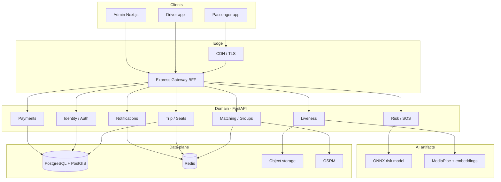

# 7. Complete system architecture

## 7.1 Style

**Modular monolith FastAPI** for MVP (one deployable, many routers), with **extractable** module boundaries. Express remains the **BFF/gateway** (auth cookie/JWT attach, SPA, mock fallback for demos). Event-driven **asynchronous** work on Redis streams / Postgres LISTEN later.

We do **not** start with 12 microservices. Matching, risk, and liveness are libraries in-process first; split when CPU/GPU or scaling demands it.

## 7.2 Logical architecture



## 7.3 Backend modules (bounded contexts)

| Module | Responsibility | Owns data |
|--------|----------------|-----------|
| **identity** | Users, sessions, RBAC, device tokens | users, sessions, consents |
| **fleet** | Drivers, vehicles, documents, enrollment | drivers, vehicles, verifications |
| **trip** | Book, assign, start, complete, occupants, holds | rides, ride_passengers, seat_reservations |
| **matching** | Geo search, overlap, groups, modal shift | match_jobs, group_offers |
| **routing** | OSRM client, corridor, ETAs | route_snapshots |
| **safety** | Risk score, deviation events, SOS, incidents | assessments, incidents |
| **liveness** | Sessions, OTP lock | verification_sessions |
| **consensus** | Votes for joins | consent_votes |
| **fare** | Quotes, splits, promotions | fare_quotes, fare_legs |
| **payments** | PG integration, ledger | payment_intents, ledger |
| **notify** | FCM/SMS/WS | notification_outbox |
| **admin** | Ops APIs | audit_logs, tickets |

## 7.4 Realtime

- **Redis Pub/Sub or Streams** per `ride:{id}` and `user:{id}`.
- Gateway or FastAPI WS gateway subscribes and pushes to sockets.
- Location: driver publishes to `loc:{driver}`; trip service updates last-known; riders subscribe to `ride:{id}:loc`.

## 7.5 Control vs data plane

- **Control:** booking, matching, votes, verification, payments — strongly consistent (Postgres).
- **Data:** GPS pings — eventually consistent (Redis, sampled to Postgres).

## 7.6 Trust boundaries

1. Public internet → TLS → gateway.
2. Gateway → FastAPI on private network (Compose `sentinel-net` today).
3. FastAPI → Postgres/Redis/OSRM private.
4. Liveness frames: processed in memory; persist embeddings only.
5. Admin network: SSO + VPN/P1 IP allowlist.

## 7.7 Alignment with current repo

```text
server.ts                 → keep as BFF
backend/app/api/v1/*     → keep routers; add seats/groups/admin
backend/app/services/*   → matching, fare, emergency stay
ai_engine/*               → keep; add enrollment matcher
src/*                     → web/demo clients
mobile_app/               → production client track (decision in doc 08)
```
