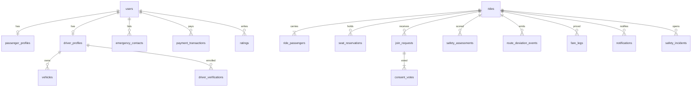

# 9. Detailed database schema

## 9.1 Design rules

- UUID primary keys for public IDs (current ORM uses integers — migrate).
- Soft deletes only where audit requires; payments and incidents **never** hard-delete.
- Money as `NUMERIC(12,2)` INR.
- Geometry: `GEOGRAPHY(Point,4326)` and `GEOGRAPHY(LineString,4326)`.
- Capacity: enforced by table design + transaction, not only application code.
- JSON allowed for telemetry extras, not for money or votes in production (votes are rows).

## 9.2 Entity-relationship (logical)



## 9.3 How many passengers share one ride without breaking capacity or money

1. `rides` stores `capacity`, `status`, `driver_id`, `vehicle_id`, corridor geometry. It does **not** store a single `passenger_id` as the only occupant (to-be).
2. Each person on the trip is a `ride_passengers` row (`role=primary|joiner`, `status=confirmed`).
3. Before confirm, `seat_reservations` holds a seat (`held` → `committed` | `expired` | `released`). Unique `(ride_id, seat_no)` where `state IN ('held','committed')`.
4. Trigger or transaction: `count(committed)+count(held) ≤ rides.capacity`.
5. Each occupant has `fare_legs` (base, share discount, detour surcharge). Payment txs point at `fare_leg_id`, not at a single ride fare blob. Primary passenger’s original quote is **recomputed transparently** when a joiner is confirmed (credit or split), never silently increased without UI.

## 9.4 Table dictionary

### users
- `id UUID PK`
- `phone UNIQUE NOT NULL`
- `phone_verified_at TIMESTAMPTZ`
- `email`
- `status` `{active,suspended,deleted}`
- `created_at`, `updated_at`
- Index: `phone`

### passenger_profiles
- `user_id PK FK users`
- `display_name NOT NULL`
- `avatar_object_key`
- `rating_avg NUMERIC(3,2)`
- `rating_count INT`
- `share_opt_in BOOL DEFAULT true`
- `show_age_band BOOL DEFAULT false`
- `show_gender_badge BOOL DEFAULT false`
- `date_of_birth DATE` (store DOB, **display band only**)
- `gender` nullable, optional

### driver_profiles
- `user_id PK FK users`
- `legal_name`
- `dl_number` encrypted/tokenized
- `rating_avg`, `rating_count`, `safety_score`
- `kyc_status` `{pending,verified,rejected}`
- `enrollment_embedding_id` FK
- `online BOOL`, `last_location GEOGRAPHY(Point,4326)`
- `active_vehicle_id`

### vehicles
- `id UUID PK`
- `driver_id FK`
- `mode` `{bike,auto,cab,van}`
- `plate`, `make`, `model`, `color`, `year`
- `capacity SMALLINT NOT NULL`
- `min_open_seats`, `max_open_seats`
- `rc_status`, `insurance_until`
- Unique `(plate)`

### driver_verification_records
- `id UUID PK`
- `driver_id FK`
- `type` `{enrollment,liveness_trip}`
- `ride_id FK NULL`
- `status` `{pending,in_progress,passed,failed,expired}`
- `attempts SMALLINT`
- `liveness_passed BOOL`
- `match_score NUMERIC`
- `otp_unlocked_at`
- `created_at`
- Retention: raw media **not** stored; `artifact_key` optional, 24h TTL if debug.

### rides
- `id UUID PK`
- `driver_id FK`
- `vehicle_id FK`
- `mode`
- `status` `{searching,offered,assigned,arrived,in_progress,completed,cancelled}`
- `capacity SMALLINT NOT NULL`
- `corridor GEOGRAPHY(LineString,4326)`
- `otp_hash`, `otp_expires_at`, `otp_unlocked BOOL DEFAULT false`
- `started_at`, `completed_at`
- Check: `capacity > 0`

### ride_passengers
- `id UUID PK`
- `ride_id FK`
- `passenger_id FK`
- `seat_no SMALLINT`
- `role` `{primary,joiner}`
- `status` `{confirmed,cancelled,no_show,completed}`
- `pickup GEOGRAPHY(Point,4326)`, `pickup_address`
- `dropoff GEOGRAPHY(Point,4326)`, `dropoff_address`
- Unique `(ride_id, passenger_id)` where status confirmed
- Unique `(ride_id, seat_no)` where status confirmed

### seat_reservations
- `id UUID PK`
- `ride_id FK`
- `seat_no SMALLINT`
- `passenger_id FK`
- `state` `{held,committed,released,expired}`
- `idempotency_key UNIQUE`
- `expires_at TIMESTAMPTZ NOT NULL`
- Partial unique: `(ride_id, seat_no)` WHERE state IN ('held','committed')

### ride_requests (intent / search)
- `id UUID PK`
- `passenger_id FK`
- `pickup`, `dropoff` geography
- `mode_pref`, `seats_needed`
- `status` `{open,matched,expired,cancelled}`
- `expires_at`

### ride_sharing_groups
- `id UUID PK`
- `status` `{proposed,partial,confirmed,expired}`
- `suggested_mode`
- `overlap_pct`, `extra_seconds`, `driver_bonus`
- `expires_at`

### group_members
- `group_id FK`, `request_id FK`, `decision` `{pending,accepted,rejected}`

### route_snapshots
- `id UUID PK`, `ride_id FK`
- `polyline`, `distance_m`, `duration_s`, `provider` `{osrm,cache,degraded}`
- `created_at`

### pickup_dropoff_points
- Used for planned stops: `ride_id`, `seq`, `kind` `{pickup,dropoff,waypoint}`, `location`, `passenger_id`

### fare_quotes / fare_legs
- Quote: snapshot of rules version.
- Leg: `ride_id`, `passenger_id`, `amount`, `components JSON` `{base,distance,time,share_discount,detour}`

### safety_assessments
- `ride_id`, `phase` `{pre,in_trip}`, `score`, `level`, `indicators JSONB`, `explanation TEXT`, `protocol JSONB`, `model_version`

### route_deviation_events
- `ride_id`, `drift_m`, `duration_s`, `gps_quality`, `action` `{logged,prompt,siren,sos_suggest}`

### notifications
- `user_id`, `type`, `payload JSONB`, `channel` `{fcm,sms,inapp}`, `status`

### emergency_contacts
- `passenger_id`, `name`, `phone`, `priority`

### safety_incidents
- `ride_id`, `opened_by`, `type` `{sos,deviation,verify_fail}`, `status`, `notes`

### ratings
- `ride_id`, `from_user`, `to_user`, `stars`, `tags[]`

### payment_transactions
- `id`, `user_id`, `fare_leg_id`, `pg_ref`, `amount`, `status` `{created,authorized,captured,refunded,failed}`

### audit_logs
- `actor_id`, `action`, `entity`, `entity_id`, `ip`, `diff JSONB`, `at`
- Immutable (insert-only).

### consents
- `user_id`, `purpose` `{share_profile,biometric,location_share,marketing}`, `granted BOOL`, `version`, `at`

## 9.5 Indexes (critical)

```sql
CREATE INDEX idx_rides_status ON rides (status);
CREATE INDEX idx_rides_corridor ON rides USING GIST (corridor);
CREATE INDEX idx_driver_last_loc ON driver_profiles USING GIST (last_location);
CREATE INDEX idx_requests_pickup ON ride_requests USING GIST (pickup) WHERE status = 'open';
CREATE INDEX idx_reservations_expiry ON seat_reservations (expires_at) WHERE state = 'held';
CREATE INDEX idx_rp_ride ON ride_passengers (ride_id);
```

## 9.6 Data retention

| Data | Retention |
|------|-----------|
| GPS points | 30 days hot, 180 days aggregated |
| Risk features | 180 days |
| Liveness frames | 0 default (process and drop) |
| Embeddings | Until driver offboarding + 30 days |
| Payments / invoices | 8 years (tax) |
| SOS incidents | 7 years |
| OTP codes | Hash only, 24h |

## 9.7 Mapping from current ORM

| Current | To-be |
|---------|--------|
| `users` mixed | split profiles |
| `rides.passenger_id` | `ride_passengers` |
| `mid_route_requests` | `join_requests` + votes table |
| `consensus_votes` JSON | `consent_votes` rows |
| `fare_splits` | `fare_legs` |
| `telemetry` | keep + Redis last-known |
| `modal_shift_suggestions` | `ride_sharing_groups` |

## 9.8 Capacity trigger (conceptual)

```sql
CREATE OR REPLACE FUNCTION enforce_capacity() RETURNS trigger AS $$
BEGIN
  IF (
    SELECT COUNT(*) FROM ride_passengers
    WHERE ride_id = NEW.ride_id AND status = 'confirmed'
  ) > (SELECT capacity FROM rides WHERE id = NEW.ride_id) THEN
    RAISE EXCEPTION 'capacity exceeded';
  END IF;
  RETURN NEW;
END;
$$ LANGUAGE plpgsql;
```

Application still uses `SELECT FOR UPDATE` — trigger is the last line of defense.
