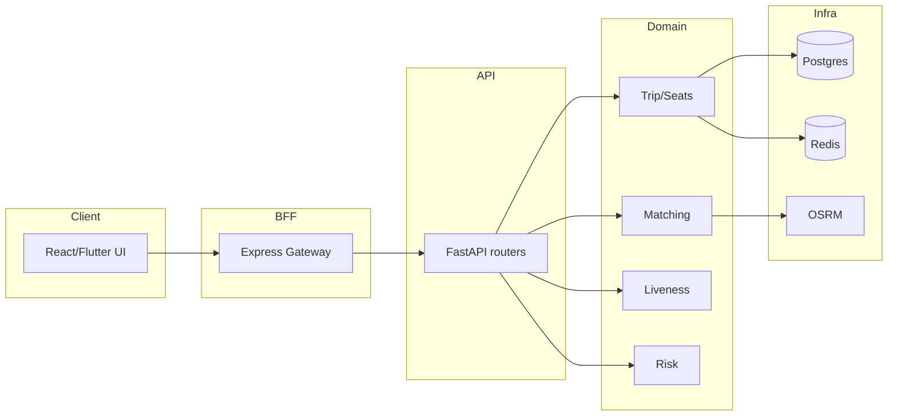
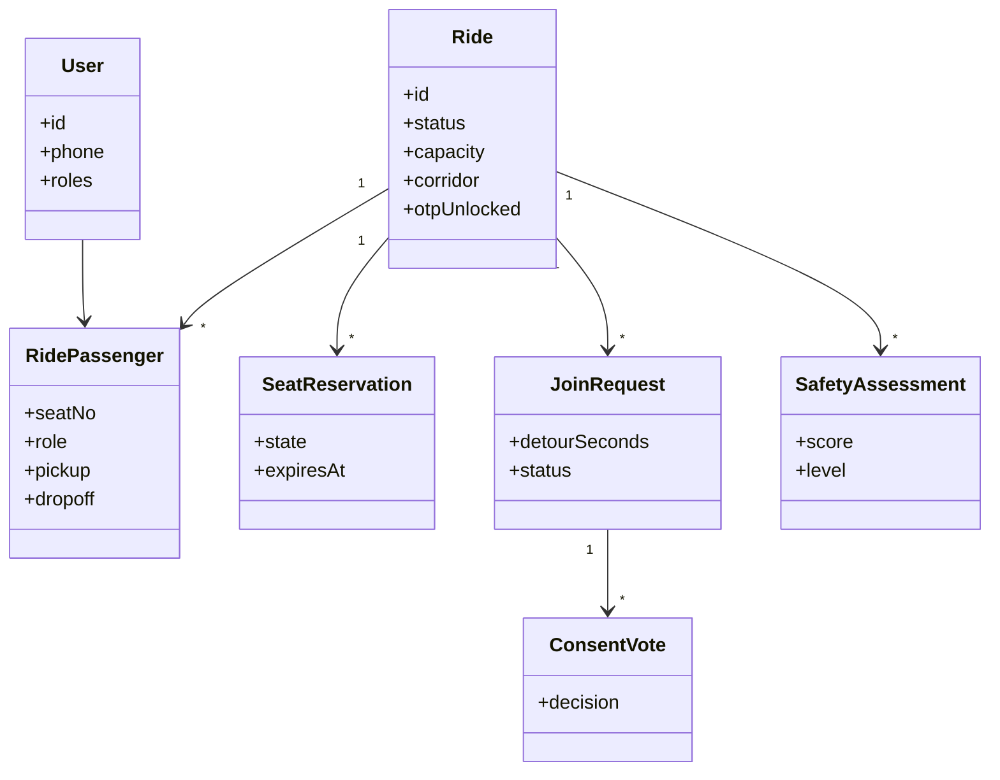
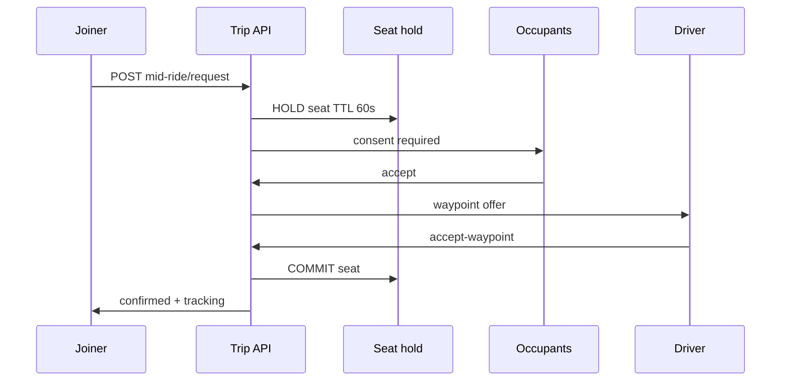
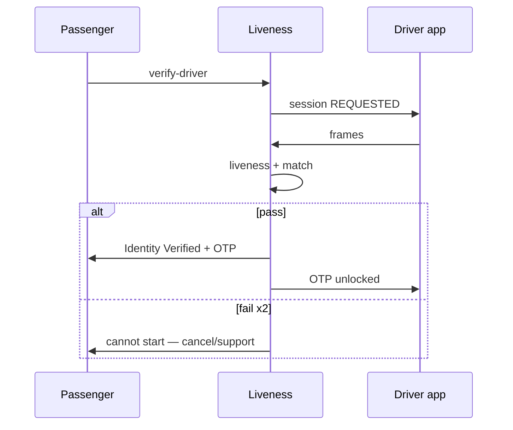
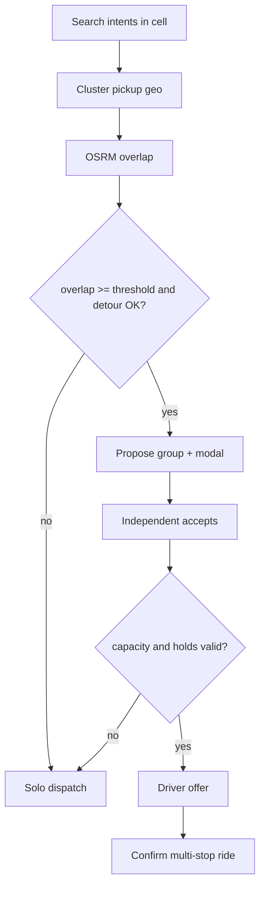
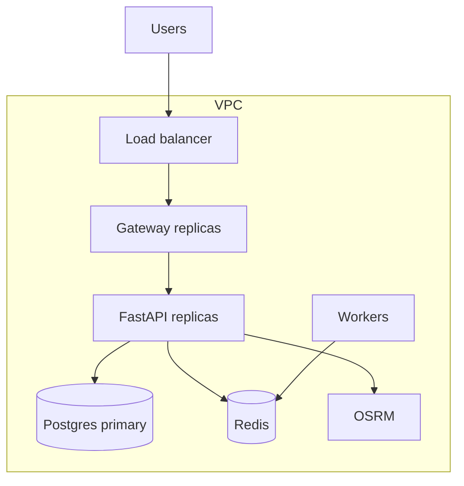

# 11. UML diagrams

Rendered in Mermaid. These are design artifacts, not generated from code.

## 11.1 Use case

```mermaid
usecaseDiagram
  actor Passenger
  actor Driver
  actor Occupant
  actor Admin
  actor SafetyOps

  Passenger --> (Register / login)
  Passenger --> (Book ride)
  Passenger --> (View risk card)
  Passenger --> (Join mid-ride)
  Passenger --> (Vote on joiner)
  Passenger --> (Verify driver)
  Passenger --> (Track ride)
  Passenger --> (SOS)
  Driver --> (Go online)
  Driver --> (Accept trip)
  Driver --> (Face liveness)
  Driver --> (Accept waypoint)
  Driver --> (Navigate / complete)
  Occupant --> (Vote on joiner)
  Admin --> (Manage users / vehicles)
  SafetyOps --> (Handle SOS / incidents)
```

## 11.2 Component



## 11.3 Class (domain, simplified)



## 11.4 Sequence — mid-ride join



## 11.5 Sequence — verify then OTP



## 11.6 Activity — group match



## 11.7 Deployment (target)



## 11.8 ERD

See [09-database-schema.md](./09-database-schema.md) §9.2.
